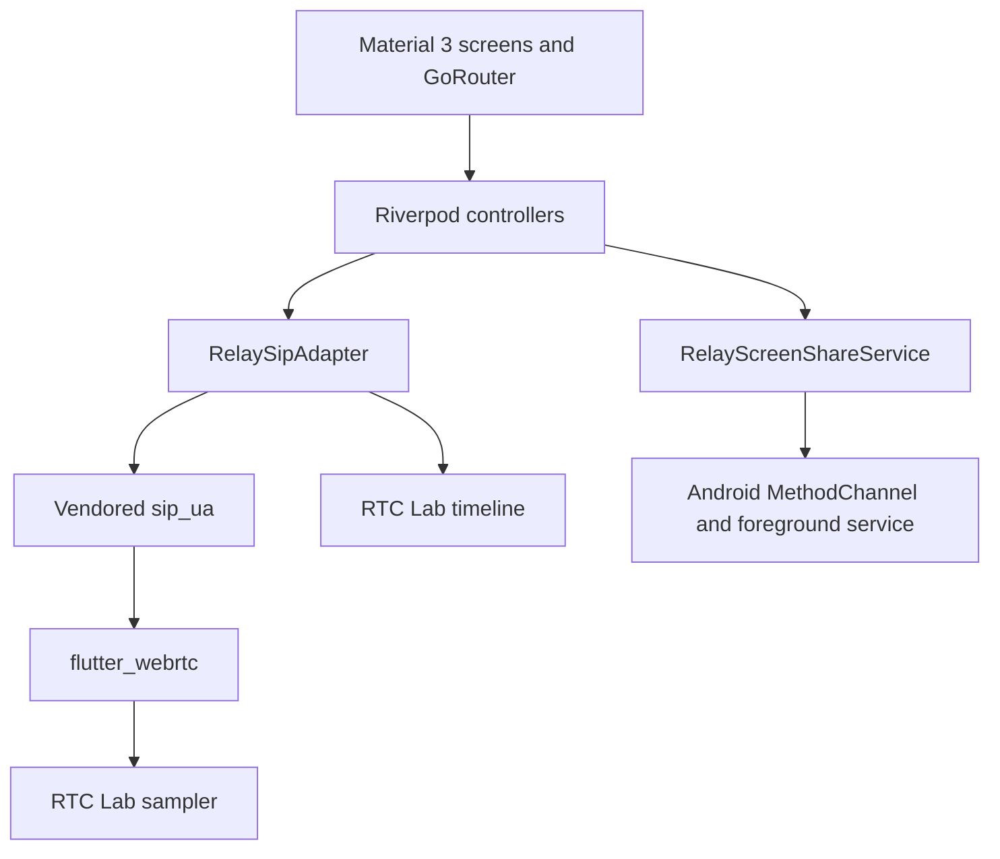

# Relay

Relay is a Flutter learning and reference application built for **“Demystifying WebRTC in Flutter: VoIP and Screen Sharing”** at **Droidcon Kenya × FlutterCon Kenya**. It demonstrates SIP registration, WebRTC audio/video, Android screen sharing and live RTC diagnostics with `sip_ua`, `flutter_webrtc`, FreeSWITCH and coturn.

Relay is an educational client, not a complete production phone system. It requires your own SIP accounts and reachable signaling/media infrastructure. Background incoming-call delivery, push notifications, CallKit/ConnectionService integration and universal device/network reliability are not established by this repository.

## Functionality and platforms

| Capability | Android | iOS |
| --- | --- | --- |
| SIP registration over WSS | Implemented | Implemented |
| Incoming/outgoing audio and video calls | Implemented | Implemented |
| Mute, speaker, camera toggle and camera switch | Implemented | Implemented |
| Audio/video transitions within a call | Implemented; device regression checks required | Same |
| Receive a shared screen through remote video | Implemented video path | Implemented video path |
| Outgoing screen sharing | Implemented using MediaProjection | **Not implemented in Relay** |
| Sharing foreground notification and Stop action | Implemented | Not applicable |
| RTC Lab statistics and event timeline | Implemented | Implemented |

Only Android and iOS projects are included. Package-level web/desktop support does not establish Relay support for those platforms. Implementation status is not a claim that a current device validation run passed; see [validation requirements](docs/cleanup-validation.md).

## Architecture



- `lib/app/`: application entry, navigation and themes.
- `lib/features/sip/`: account configuration, secure persistence, registration and the SIP adapter.
- `lib/features/call/`: call state/presentation, media acquisition, track replacement and renderers.
- `lib/features/call/services/`: bridge to Android sharing lifecycle notifications.
- `android/app/src/main/kotlin/com/code4flare/relay/`: MediaProjection foreground service and notification-stop bridge.
- `lib/features/rtc_lab/`: WebRTC statistics, selected ICE path and bounded event history.
- `lib/shared/logging/`: console logging policy that emits reviewed event labels only.
- `packages/sip_ua/`: a deliberately preserved local fork; see [provenance and patches](packages/sip_ua/RELAY-FORK.md).

The SIP stack owns the peer connection. `CallController` owns application-supplied capture streams. Call widgets own video renderers. The existing audio-call strategy negotiates a dormant video transceiver; transitions reuse its sender rather than creating a new call.

FreeSWITCH handles SIP routing and call legs. ICE/STUN/TURN determine connectivity on each media leg. A relay candidate being gathered does not prove TURN was selected. Do not assume media is direct between phones or end-to-end encrypted through a media-anchoring server.

## Toolchain

The inspected working environment used Flutter **3.47.0** / Dart **3.13.0**. The committed lockfile requires Flutter `>=3.47.0`; retain it for reproducibility. The cleanup did not execute Flutter or verify a fresh build.

- Android: minimum SDK 26, compile SDK 37, Java compatibility target 17, AGP 9.1.0 and Gradle 9.3.1. Install the corresponding Android SDK/toolchain supported by the pinned Flutter setup. `targetSdk` and NDK version come from Flutter.
- iOS: deployment target 15.0, Xcode and signing suitable for your installed Flutter version; the project uses Flutter Swift Package Manager integration.
- Locked media/UI versions: `flutter_webrtc` 1.6.3, local `sip_ua` 1.1.0 and `material_ui` 1.9.0.

Do not replace the SIP fork or upgrade the media/UI packages as a setup step. Use your own iOS team and, when needed, application identifiers. Android release builds currently use debug signing: configure your own release signing before distributing binaries. Never commit signing keys.

## Local setup

1. Obtain the repository and install the toolchain above.
2. Review the lockfile and local SIP override.
3. Install dependencies and launch on a physical device:

```sh
flutter pub get
flutter run
```

No `.env` file is required. Relay does **not load or bundle `.env`**. `.env.example` is a reference worksheet with reserved example domains, not a runtime configuration file. `assets/brand/` was an empty local directory and is no longer declared as a required asset; the existing image/launcher assets remain unchanged.

### Configure a SIP account

Open **Settings → SIP account** and enter:

| Field | Meaning |
| --- | --- |
| WebSocket server | Complete WSS endpoint, including custom port/path if required, e.g. `wss://pbx.example.org:7443` |
| SIP domain | Account realm/routing domain, e.g. `example.org`; this can differ from the WSS host |
| Extension | Account identifier provisioned on your server |
| Password | Account password; stored using secure storage |
| STUN URL | Optional explicit `stun:`/`stuns:` server URI |
| TURN URL | Optional explicit `turn:`/`turns:` server URI |
| TURN username/password | Required when configuring TURN; stored using secure storage |

The example domains do not provide a service. Relay has no personal-server fallback. WSS certificate validation remains enabled. Do not embed credentials in URLs. New account saves require WSS; existing saved account values are not rewritten automatically.

A TURN URL without a transport query retains the existing UDP/TCP candidate configuration. An explicit `?transport=udp` or `?transport=tcp` configures that transport only. With no configured ICE servers, no external STUN/TURN service is contacted; this may work on a reachable private network but is not sufficient for every NAT/firewall.

**Migration from earlier local builds:** existing SIP server/domain/extension/password storage keys are preserved. Values formerly supplied through a local `.env` cannot be read safely from a distributed application. Enter your previous STUN/TURN values in the account form once and select **Save & connect** before testing calls that require TURN. Your local `.env` is not deleted or rewritten. TURN credential renewal is manual; no credential-issuing backend is added here.

### Companion server

The identified companion is [Jerome-Jumah/relay-server](https://github.com/Jerome-Jumah/relay-server). Its availability to public contributors must be confirmed before publishing Relay.

Follow that repository's README to prepare your own local/private FreeSWITCH and coturn deployment. Record the backend revision you tested. Configure SIP users, WSS certificates, reachable advertised media addresses, RTP/TURN relay port ranges and firewall rules there. A loopback address on a phone refers to the phone, not your development computer; use a reachable server address and a trusted WSS certificate.

Relay does not deploy or require access to the author's live infrastructure. Never expose administrative interfaces or copy demo credentials into a public deployment.

## Walkthroughs

### First audio call

1. Provision two distinct SIP accounts and configure two physical devices.
2. Save/connect each account and confirm registered status.
3. Enter the other extension on Home and select **Audio call**.
4. Grant microphone access, answer on the second device, and verify audio both ways.
5. Test mute, speaker and hangup from each side. Use headphones or separate rooms to avoid feedback.

### Video and transitions

Select **Video call**, grant camera/microphone access and verify moving frames on both devices. Test camera toggle and switch. During an audio call, switch to video, then back to audio. A receive-only remote video track can exist while its transceiver is dormant; track presence alone does not mean active video.

Direct-video capture ownership and transition cleanup have known lifecycle concerns that are intentionally outside this cleanup. Test direct video and upgraded video separately, especially after sharing or downgrade.

### Android screen sharing

During an established call, select Share, approve the system capture request, then show safe, visibly changing content. Verify the other device receives those frames. Stop through the in-app control, Android notification and system capture control. Verify return to the previous presentation and continued audio.

Android 14 requires per-session MediaProjection consent and the media-projection foreground-service permissions/type. Relay preserves the working sequence: **consent → foreground-service start → existing readiness delay → display capture**. Do not reorder it as a cleanup. The notification Stop action is forwarded back to Dart, including its deferred path when the channel is unavailable. See [Android MediaProjection requirements](https://developer.android.com/media/grow/media-projection).

**Outgoing iOS screen sharing is not implemented.** There is no Relay ReplayKit Broadcast Upload Extension integration. The current share control is not comprehensively platform-gated; its presence on iOS must not be interpreted as support.

## RTC Lab and privacy

Open RTC Lab during a call to inspect registration, peer/ICE/signaling state, selected candidate pair, codecs, packet counters, bitrate, jitter/loss, video source and transceiver direction. Counters and the local event timeline remain available independently of console logging.

- Selection precedence is transport-selected pair ID, selected pair, then nominated/succeeded pair; otherwise selection is unavailable.
- “Force TURN”, overlay and verbose-event switches are preview controls, not live transport settings.
- “Copy real diagnostics” includes account/peer and network addresses. Review/redact it before sharing in issues or on a projector.
- Console logs retain fixed lifecycle labels and omit payloads, endpoint/identity values, exception text and stack traces. A custom SIP logger must enforce the same privacy policy.

### Optional Sentry

Sentry is disabled by default and is not initialized without an explicit `RELAY_SENTRY_DSN` build define. For an authorized Sentry project you may opt in:

```sh
flutter run --dart-define=RELAY_SENTRY_DSN=YOUR_PUBLIC_DSN --dart-define=RELAY_APP_ENV=development
```

The DSN is a public ingestion address. Never use build defines for SIP passwords, TURN credentials, tokens or shared secrets. The opt-in path sends a fixed error summary instead of exception/scope data; breadcrumbs, screenshots, view hierarchy, automatic performance/session collection and native crash handling are disabled. Detailed telemetry requires a separately reviewed privacy design.

## Troubleshooting and limitations

| Symptom | Checks |
| --- | --- |
| Registration fails | WSS scheme/host/port/path, certificate trust, SIP domain, extension/password and server reachability |
| Registration works, audio fails | Microphone permission, advertised media addresses, codecs, RTP firewall rules and the actual ICE-selected path |
| Calls stopped traversing NAT after migration | Enter the previous local STUN/TURN settings in the runtime form and reconnect |
| Video is absent after transition/share | Inspect active intent, transceiver direction, sender/source and byte/frame counters; camera ownership/restoration remains a known follow-up |
| Share denied/fails | Android consent, foreground-service sequence, device OS restrictions and notification lifecycle |
| Settings load fails | Reopen the account screen; storage failures are shown without raw exceptions |
| Settings seem ineffective | Audio-route preference, self-view mirror and quality preferences are persisted but not wired into all call/rendering behavior |

The current application supports one active call. Preview/fallback media surfaces and some route parameters remain from early UI work. Connectivity recovery, long/background calls, concurrent transitions and cleanup races need further device testing. See [release blockers and validation](docs/cleanup-validation.md).

## Build, test and contribute

Commands for a future authorized validation run:

```sh
flutter analyze
flutter test
flutter build apk --debug
# On macOS with Xcode:
flutter build ios --no-codesign
```

Root analysis excludes `packages/**`; SIP-fork changes also require focused package review/checks. The existing tests primarily cover UI and do not prove real SIP, capture, renegotiation or notification behavior. Complete the manual checklist before release; no build/test pass is claimed by this cleanup.

Keep changes small and preserve the dormant-transceiver strategy, Android consent/service order, restoration and notification-stop behavior. Do not include `.env`, signing material, raw signaling, local recordings, generated reports or `tmp/` in contributions. Keep source changes separate from dependency upgrades.

See [CONTRIBUTING.md](CONTRIBUTING.md) for contribution, validation and licensing guidance.

## Conference and learning resources

- Talk: **Demystifying WebRTC in Flutter: VoIP and Screen Sharing**, Droidcon Kenya × FlutterCon Kenya.
- Public presentation slides: **TODO — owner to supply the reviewed public URL.**
- Conference recording: **TODO — add only if available and approved.**
- Android screen-sharing article: **TODO — owner to supply the public URL.**
- Companion backend: [relay-server](https://github.com/Jerome-Jumah/relay-server) — confirm public access and add a tested revision.
- [Upstream Dart SIP UA](https://github.com/flutter-webrtc/dart-sip-ua).
- [Flutter WebRTC](https://github.com/flutter-webrtc/flutter-webrtc).

README screenshots are pending current-device captures with sanitized accounts/content and publication permission. Existing local preview screenshots are not presented as evidence of live media.

## License and assets

Relay-owned source code and documentation are licensed under the [MIT License](LICENSE). Third-party code retains its own terms, including the [vendored SIP MIT notice](packages/sip_ua/LICENSE).

The source-code license does not automatically cover the Relay logo/icons, conference photographs, presentation slides, recordings or third-party assets. Their ownership and redistribution terms remain unverified. See [third-party and asset obligations](THIRD-PARTY-NOTICES.md).
